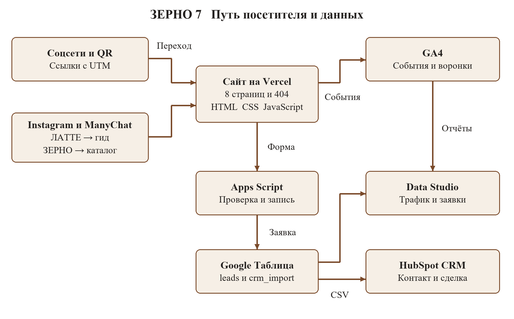
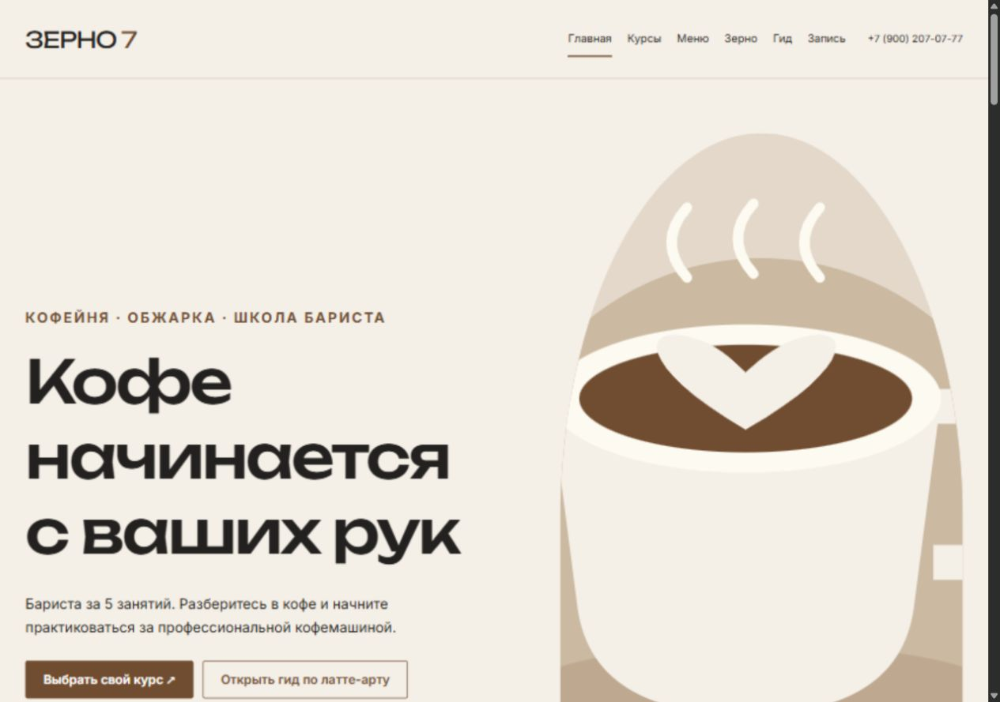
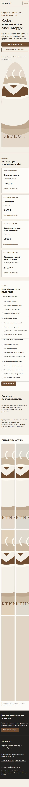
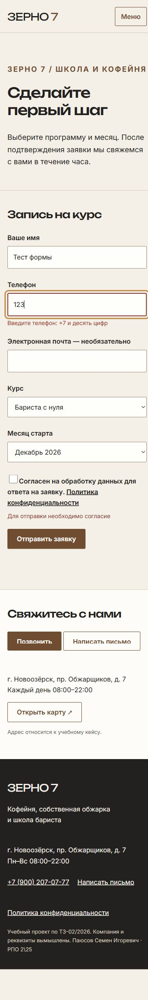

# Разработка сайта и системы учёта заявок для кофейни и школы бариста Зерно 7

Курсовая работа по дисциплине ОП.03 «Информационные технологии»

АВТОНОМНАЯ НЕКОММЕРЧЕСКАЯ ОРГАНИЗАЦИЯ
ПРОФЕССИОНАЛЬНАЯ ОБРАЗОВАТЕЛЬНАЯ ОРГАНИЗАЦИЯ
МОСКОВСКИЙ МЕЖДУНАРОДНЫЙ КОЛЛЕДЖ ЦИФРОВЫХ ТЕХНОЛОГИЙ «АКАДЕМИЯ ТОП»

Выполнил: Паюсов Семен Игоревич

Группа: РПО 2\25

Санкт-Петербург, 2026

## Введение

Для кофейни, которая одновременно продаёт напитки, обжаривает зерно и проводит обучение, сайт должен помогать решать разные задачи посетителей. Будущему ученику нужны программа и дата курса, покупателю зерна — сведения о продукте, гостю кофейни — меню и адрес. При этом руководителю важно понимать, какие публикации приводят к обращениям и какие обращения завершаются оплатой. Эта связь определяет содержание настоящей курсовой работы.

Объект исследования — процесс привлечения клиентов и обработки обращений в учебном кейсе ООО «Зерно Семь». Предмет исследования — применение статического сайта, веб-аналитики, UTM-разметки, электронных таблиц и CRM для учёта заявок на обучение.

Цель работы — разработать проект сайта и информационного контура, который сохраняет источник обращения и позволяет проследить заявку от перехода из социальной сети до оплаты курса. Для достижения цели необходимо проанализировать задачу заказчика, определить структуру страниц, описать события аналитики, спроектировать приём заявок, автоматические ответы, отчётность и передачу данных в CRM.

В работе применяются анализ требований, моделирование пользовательского пути, проектирование структуры данных и разработка сценариев проверки. Исходные сведения о компании и числовые показатели взяты из ТЗ № ТЗ-02/2026 от 08.10.2026 [1]. Организация, реквизиты и должностные лица в этом задании относятся к вымышленному учебному кейсу.

Практическая значимость проекта состоит в создании единого порядка регистрации обращений. Руководитель школы сможет сопоставлять канал привлечения с курсом, месяцем старта и текущей стадией сделки, а затем принимать решения на основании сопоставимых показателей.

## 1 Задача заказчика

### 1.1 Характеристика компании

«Зерно 7» — кофейня на 40 мест с собственной обжаркой. С 2024 года при ней действует школа бариста. Занятия проходят в отдельном классе с тремя профессиональными кофемашинами; численность обычной учебной группы ограничена шестью участниками. Корпоративный мастер-класс рассчитан на команду до двенадцати человек [1, с. 2–3].

Школа предлагает четыре направления. Курс «Бариста с нуля» включает пять занятий по три часа и стоит 14 900 рублей. Курс латте-арта включает три занятия и стоит 8 900 рублей. Альтернативное заваривание рассчитано на два занятия и стоит 5 900 рублей. Корпоративный мастер-класс стоит 24 000 рублей за команду. Эти значения определяют карточки курсов и справочник для формы заявки.

Целевая аудитория состоит из студентов 18–25 лет, ищущих подработку в кофейнях, любителей кофе 25–40 лет и владельцев небольших кафе, которым требуется обучить персонал. На сайте следует объяснять профессиональные термины при первом использовании и обращаться к посетителю на «вы».

### 1.2 Проблема существующего процесса

По данным письма директора, за сентябрь 2026 года поступило 126 вопросов о курсах, а записались 29 человек. Школа приносит 35% выручки компании. Видео с латте-артом набирают 20–40 тысяч просмотров; на обзоры блогеров выделяется 15 000 рублей в месяц. Однако связь просмотров и рекламных размещений с записью на обучение не измеряется [1, с. 2].

Отношение числа записавшихся к числу вопросов составляет 29 / 126 × 100% = 23,02%. Это исходное отношение показателей из задания, а не измеренная конверсия сайта. Для трактовки его как конверсии людей необходимо подтвердить, что вопросы принадлежат уникальным людям, а записи относятся к той же группе и тому же периоду. Разность 126 − 29 = 97 также нельзя объявлять количеством потерянных или оставшихся без ответа клиентов: такой учёт ранее не вёлся.

Главная организационная проблема заключается в разрозненности обращений. Администратор отвечает в личных сообщениях между обслуживанием гостей, сведения об источнике не фиксируются единообразно, а руководитель не получает полной картины движения обращения. Большое число просмотров само по себе не позволяет оценить результат рекламы.

### 1.3 Требуемый результат

Набор в декабрьские потоки по заданию открывается 15 ноября 2026 года. К этому моменту предусмотрен сайт с программами, расписанием и формой записи. Каждая подтверждённая заявка должна попадать в одну таблицу, сохранять источник и передаваться в CRM [1].

Результат проекта оценивается по проверяемым признакам: страницы доступны на телефоне, метки сохраняются до отправки формы, приёмник проверяет данные, повторный запрос не создаёт вторую строку, а событие успешной заявки возникает после подтверждения записи. Отдельно оцениваются работа автоответов, отчётов и связь контакта со сделкой.

## 2 Схема работы

Рисунок 1 — Проектная схема движения посетителя и данных

Пользователь переходит на сайт из Instagram, ВКонтакте, Telegram, YouTube, публикации партнёра или по QR-коду. Внешняя ссылка содержит UTM-метки. В Instagram предусмотрен дополнительный путь: комментарий под Reel запускает сообщение ManyChat, а кнопка в сообщении ведёт на целевую страницу.

Сайт выполняет две независимые операции. Действия посетителя передаются в GA4 как события. Данные заполненной формы направляются в Apps Script, который проверяет запрос и записывает заявку в Google Таблицу. Сбой аналитики не должен блокировать регистрацию обращения. Для бизнес-учёта подтверждённая строка таблицы является первичным фактом поступления заявки.

Далее сведения разделяются по назначению. GA4 помогает изучать посещаемость и поведение, таблица хранит обращения, HubSpot отражает работу с клиентом до оплаты, а Data Studio сводит показатели на страницах отчёта. Связь таблицы и CRM поддерживается через идентификатор request_id.

В проекте используются сервисы, названные в индивидуальном ТЗ: Data Studio и HubSpot. Структура описания соответствует примеру курсовой в репозитории [2], однако упомянутый в общем шаблоне DataLens не подменяет систему отчётности индивидуального задания.

## 3 Сайт

### 3.1 Выбор технического решения

ТЗ предусматривает обычные файлы HTML, CSS и JavaScript, которые открываются в браузере без сборки. Такое решение соответствует масштабу проекта: страницы в основном информационные, а интерактивность ограничена фильтрами, тестом, галереей и формой. Обработку заявки выполняет отдельный приёмник [1, разд. 3].

HTML задаёт структуру содержания, CSS — оформление и адаптивность, JavaScript — реакцию интерфейса и обмен данными. Общие стили размещаются в css/, сценарии — в js/, изображения — в img/, PDF-программы и гайд — в files/. Вызовы аналитики объединяются в js/analytics.js, обработка формы — в js/form.js.

Использование нейросети допускается для подготовки структуры, текстов и кода. Однако результат генерации необходимо проверять по требованиям. В docs/prompts.md фиксируются фактически отправленные запросы, полученный результат и ручные исправления. Запись несуществовавших запросов или выдуманной истории разработки недопустима.

### 3.2 Структура страниц

| Файл | Назначение и основные элементы |
|---|---|
| index.html | Главная: предложение обучения, четыре курса, тест, преподаватели, фотографии класса и повторный призыв к записи |
| courses.html | Программы четырёх курсов, даты потоков, свободные места, программа в PDF и пять частых вопросов |
| menu.html | Меню с фильтрами по категориям, позиции с ценами, карта и адрес |
| beans.html | Карточки шести сортов, объяснение степени обжарки и переход к контакту для заказа |
| latte-guide.html | Пять шагов гида, PDF для скачивания, промокод LATTE10 и переход к курсу |
| contacts.html | Форма заявки, телефон, электронная почта и кнопки мессенджеров |
| thanks.html | Подтверждение, номер зарегистрированной заявки, дальнейшие действия и социальные сети |
| privacy.html | Сведения об операторе, целях, составе данных и условиях обработки |
| 404.html | Сообщение об отсутствии страницы и навигация для возврата |

Таблица 1 — Состав сайта по индивидуальному заданию

Восемь основных страниц и страница ошибки разделяют разные пользовательские задачи. Главная объясняет предложение, страница курсов помогает выбрать обучение, а контакты завершают путь заявкой. Меню и зерно обеспечивают представление других направлений кофейни, не смешивая покупку товара с записью на курс.

Для «Бариста с нуля» в задании указаны старты 2 и 16 декабря 2026 года и 13 января 2027 года. Для латте-арта — 7 декабря 2026 года и 20 января 2027 года; для альтернативного заваривания — каждую субботу. Число мест у потока хранится в массиве JavaScript; запись на поток без мест блокируется. Такой массив является отображением расписания, а не полноценной системой бронирования: актуальность значений обеспечивает ответственный сотрудник.

### 3.3 Оформление и интерактивность

Фирменная палитра включает кофейный #7A4A2A, сливочный #F6EFE6 и графитовый #24211F. Для заголовков предусмотрен Unbounded, для текста — Inter. На страницах используются единые шапка и подвал, а активный пункт меню выделяется. Основное действие формулируется конкретно: выбрать поток, записаться на курс или открыть гайд.

Тест на главной содержит четыре вопроса. Ответы сопоставляются четырём направлениям обучения по заранее описанным правилам; результат сопровождается кнопкой записи. Для одинакового набора ответов должен получаться одинаковый результат, а при равенстве баллов требуется фиксированное правило выбора. Правила следует хранить в docs/quiz.md. Тест помогает сориентироваться в предложении и не заменяет консультацию администратора.

В задании есть содержательное противоречие: приложение А требует не менее двадцати позиций меню и шесть сортов зерна, тогда как раздел 2 содержит лишь часть исходных сведений и запрещает добавлять отсутствующие цены и услуги. До наполнения этих блоков необходим согласованный каталог. Аналогично следует получить подтверждённые сведения о преподавателях. Заполнять эти пробелы вымышленными биографиями и ценами нельзя.

### 3.4 Проверка качества и публикация

Проверка адаптивности проводится при ширине 375, 768 и 1280 пикселей. Критерии: отсутствие горизонтальной прокрутки, читаемый текст, работающее меню и размер нажимаемых элементов не менее 44 × 44 пикселей. Изображения должны иметь альтернативные описания и размер файла до 300 КБ. Каждой странице необходимы собственные title, description и данные Open Graph.

ТЗ устанавливает минимальные оценки мобильного Lighthouse: Performance — 70, Accessibility — 90, SEO — 90. Это пороги приёмки, которые необходимо подтвердить отчётом после публикации. Они не являются результатами измерения настоящего текста.

Публикация предусмотрена в Vercel из публичного репозитория tz-02-kofeynya-zerno7. Обновление сайта связывается с отправкой изменений в main. В истории должно быть не менее десяти содержательных коммитов, включая исходный результат генерации. Доменные имена с окончанием .example из реквизитов кейса не используются как адрес опубликованного сайта.

## 4 Аналитика GA4

### 4.1 Модель измерения

Событие — зарегистрированное действие посетителя, например просмотр страницы, выбор даты или отправка обращения. Параметры уточняют его содержание: какой курс выбран, в каком блоке нажата кнопка, какой мессенджер открыт. Официальная документация GA4 описывает автоматические, расширенные, рекомендуемые и пользовательские события [3].

Для проекта предусмотрен отдельный ресурс «ЗЕРНО 7 — сайт», московский часовой пояс и валюта RUB. Тег этого ресурса требуется установить в head всех страниц, включая 404.html. Расширенная статистика должна учитывать взаимодействие с формами. Реальный Measurement ID берётся из созданного ресурса и не заменяется примерным значением.

Измерение строится вокруг пути page_view → view_course → cta_click → form_start → generate_lead. При этом не каждый успешный посетитель обязан пройти все промежуточные действия. Человек может сразу открыть контакты. Поэтому аналитический сценарий необходимо отличать от единственно допустимого пути интерфейса.

### 4.2 Перечень событий

| Событие | Условие регистрации | Параметры по ТЗ |
|---|---|---|
| page_view | Открытие страницы | page_title, page_location |
| scroll | Достижение 90% страницы | percent_scrolled |
| click | Переход по внешней ссылке | link_url, outbound |
| file_download | Скачивание PDF | file_name, file_extension |
| form_start | Первое взаимодействие с формой | form_id |
| form_submit | Отправка формы | form_id |
| generate_lead | Получение ok: true от приёмника | lead_course, lead_source |
| cta_click | Нажатие кнопки заявки | button_name, page_section |
| view_course | Клик по карточке курса | course_name |
| select_course_date | Выбор потока | course_name, start_date |
| quiz_complete | Завершение теста | quiz_result |
| menu_filter | Изменение фильтра меню | filter_value |
| bean_view | Клик по карточке зерна | bean_name, roast_level |
| promo_copy | Успешное копирование промокода | promo_code |
| contact_click | Клик по телефону или почте | contact_type |
| messenger_click | Переход в мессенджер | messenger |
| social_click | Переход в социальную сеть | network, page_section |
| form_error | Ошибка поля или приёмника | field_name, error_type |

Таблица 2 — Восемнадцать обязательных событий

Состав включает шесть автоматических или расширенных событий, одно рекомендуемое generate_lead и одиннадцать собственных событий. Дополнительно в ТЗ предусмотрены map_open с параметром map_service и gallery_view с параметром photo_index. Их можно включить сверх обязательного набора.

Ключевыми по ТЗ являются только generate_lead, contact_click и messenger_click. Их смысл различается: первое подтверждает регистрацию заявки, остальные показывают намерение связаться. Поэтому сумма всех ключевых событий не равна числу заявок и не должна называться числом клиентов.

### 4.3 Организация кода и контроль данных

Все явные вызовы gtag('event', ...) располагаются в analytics.js. Кнопки размечаются data-атрибутами, а общий обработчик определяет событие и параметры. Автоматическую регистрацию нельзя без проверки дублировать ручным вызовом: это может завысить показатели. Особенно важно проверить работу form_start и form_submit при асинхронной отправке формы.

Событие generate_lead отправляется только после ответа приёмника {"ok": true}. Нажатие кнопки, прохождение клиентской проверки или открытие thanks.html сами по себе не доказывают запись в таблицу. При ответе с ошибкой возникает form_error с error_type = server, а пользователь сохраняет возможность исправить или повторить отправку.

В пользовательские определения уровня события входят button_name, page_section, course_name, quiz_result, lead_course, bean_name и messenger. Эти семь параметров делают значения доступными для требуемых разрезов отчётности. Каждое обязательное событие следует отдельно вызвать в DebugView и сохранить кадр с раскрытыми параметрами.

Имена, телефоны и электронные адреса не включаются в события и URL аналитики. Параметры ограничиваются техническими значениями из справочников. Имена событий записываются в snake_case и укладываются в лимиты ТЗ. Перед приёмкой отладочный режим в рабочем коде отключается.

## 5 UTM ссылки и социальные сети

### 5.1 Назначение разметки

UTM-параметры позволяют обозначить источник, канал, кампанию и конкретное размещение. Их назначение описано в справке Google Analytics [4]. Для проекта utm_source отвечает на вопрос «откуда пришёл посетитель», utm_medium — «к какому каналу относится переход», utm_campaign — «какую кампанию оцениваем», utm_content — «какая публикация сработала».

Для набора принят идентификатор barista_dec_2026. Ветка продажи зерна использует beans_dec_2026. Смешение этих кампаний затруднило бы оценку набора в школу: переход к зерну и запись на обучение имеют разные цели.

По правилам ТЗ значения записываются строчными латинскими буквами, цифрами и знаком подчёркивания. Допустимые medium: social, affiliate, qr, email, cpc и referral. Параметры располагаются после вопросительного знака и до якоря. Ссылка сначала фиксируется в реестре, затем используется в публикации.

### 5.2 Проект реестра

| Код | Источник и канал | Кампания | Содержание и страница |
|---|---|---|---|
| U-01 | instagram / social | barista_dec_2026 | bio → index.html |
| U-02 | instagram / social | barista_dec_2026 | reel_latte_01 → latte-guide.html |
| U-03 | instagram / social | beans_dec_2026 | reel_latte_01_beans → beans.html |
| U-04 | instagram / social | barista_dec_2026 | stories_01 → courses.html |
| U-05 | vk / social | barista_dec_2026 | post_01 → courses.html |
| U-06 | vk / social | barista_dec_2026 | market_card → courses.html |
| U-07 | telegram / social | barista_dec_2026 | post_01 → index.html |
| U-08 | telegram / social | barista_dec_2026 | district_chat → index.html |
| U-09 | youtube / social | barista_dec_2026 | video_grind_01 → courses.html |
| U-10 | Ник первого партнёра / affiliate | barista_dec_2026 | review_01 → index.html |
| U-11 | Ник второго партнёра / affiliate | barista_dec_2026 | partner_link_01 → courses.html |
| U-12 | cup_qr / qr | barista_dec_2026 | cup_sticker → latte-guide.html |

Таблица 3 — Проект двенадцати размещений

Для карточки товара ВКонтакте выбрана courses.html: посетитель уже проявил интерес к конкретной услуге и должен сразу увидеть программу и поток. Для QR-кода на стакане выбрана страница гида: она продолжает интерес гостя к приготовлению кофе и предлагает переход к обучению. Ники двух партнёров должны соответствовать реальным согласованным размещениям; произвольные имена не позволят сопоставить расходы с результатом.

### 5.3 Сохранение и проверка источника

При первом размеченном входе сценарий читает четыре параметра URL и сохраняет их в sessionStorage. На внутренних страницах без меток сохранённые значения остаются доступными. В рамках проекта целесообразно сохранять первый полный размеченный вход текущей сессии вкладки; более сложную модель повторных внешних переходов следует отдельно согласовать и документировать.

Внутренние ссылки сайта не размечаются рекламными UTM, чтобы не подменять исходный источник. Для прямого входа при отсутствии сохранённых меток применяются значения из ТЗ: direct, none, not_set, not_set. Такая запись — правило таблицы заявок; она не гарантирует полного совпадения с правилами атрибуции GA4.

Проверять ссылку нужно из фактической публикации, а не только вставкой в адресную строку. После перехода сопоставляются URL, данные Realtime и значения тестовой заявки в таблице. Для сокращённой ссылки дополнительно проверяется сохранность параметров после перенаправления. QR-код сканируется с другого устройства. Скриншот реестра без проверки перехода не подтверждает работу источника.

## 6 Заявки

### 6.1 Структура хранения

Google Таблица получает название «Zerno7 — Leads», основной лист — leads. Одна строка соответствует одному обращению. Порядок столбцов: request_id, created_at, name, phone, email, course, start_month, utm_source, utm_medium, utm_campaign, utm_content, status [1, разд. 6].

Идентификатор создаётся в форме по схеме REQ- плюс UUID. Время created_at назначает приёмник, а не браузер. Имя содержит от 2 до 60 символов, телефон нормализуется к формату +7 и десять цифр, электронная почта необязательна, но при заполнении проверяется. Курс выбирается из barista_basic, latte_art, alternative, corporate, месяц — из dec_2026, jan_2027, feb_2027.

Статус первоначально равен new. Далее разрешены contacted, prepaid, paid и lost. Для списков применяется проверка данных, для пустых обязательных полей и повторяющихся request_id — условное форматирование. Телефон хранится как текст, чтобы не потерять знак «+» и не превратить его в вычисляемое значение.

### 6.2 Последовательность отправки

Сначала пользователь заполняет поля и отмечает согласие, которое по умолчанию выключено. Клиентская проверка сообщает об ошибке рядом с соответствующим полем. Во время отправки кнопка недоступна. JavaScript передаёт данные через fetch без перезагрузки страницы.

Apps Script принимает POST-запрос функцией doPost(e). Такой способ обработки веб-запросов предусмотрен документацией платформы [5]. Приёмник повторно проверяет обязательность полей, форматы, допустимые значения и длину строк. Это необходимо, поскольку запрос может прийти в обход формы.

После успешной проверки приёмник ищет request_id, записывает новую строку и возвращает JSON с ok: true. Только затем сайт регистрирует generate_lead, сохраняет номер подтверждённого обращения для страницы благодарности и переводит пользователя на thanks.html. При ошибке запись не подтверждается, а интерфейс показывает понятное сообщение.

В браузерной интеграции требуется проверить чтение ответа опубликованного Apps Script с домена Vercel, включая перенаправления и междоменные ограничения. Режим no-cors не подходит для подтверждения успеха: непрозрачный ответ нельзя прочитать и проверить на ok: true. Успех сетевой отправки не равен подтверждению записи.

### 6.3 Защита от дублей и ошибок

Двойной клик ограничивается блокировкой кнопки, а повторная доставка — проверкой request_id на сервере. Для конкурентных запросов проверка и запись должны выполняться в одном защищённом участке, например с блокировкой Apps Script. Простая проверка перед записью без защиты допускает ситуацию, когда два одновременных запроса оба ещё не видят существующую строку.

Повтор с тем же идентификатором по ТЗ возвращает ошибку и не создаёт вторую строку. При неопределённом сетевом результате идентификатор исходной попытки сохраняется. Генерация нового UUID при каждом повторе могла бы зарегистрировать одно и то же обращение несколько раз. В спорной ситуации интерфейс должен предложить проверить регистрацию, а не уверенно объявлять, что заявка отсутствует.

Поля created_at и status формируются приёмником; статус из браузера игнорируется. Входные значения, которые табличный сервис способен трактовать как формулы, должны записываться безопасно как текст. Пароли и ключи доступа не размещаются в публичном репозитории. Доступ к таблице выдаётся адресно, а кадры для защиты обезличиваются.

### 6.4 Подготовка данных для CRM

Лист crm_import формируется из leads средствами формул. Имя очищается от лишних пробелов, отделяются first_name и last_name, телефон приводится к согласованному виду, код курса преобразуется в понятное название, а статус — в стадию сделки. В названии сделки объединяются имя, курс и месяц старта.

Разделение полного имени по пробелам является техническим приближением. Если посетитель указал только имя, фамилия остаётся пустой; нельзя переносить имя в оба поля или выдумывать недостающую часть. request_id сохраняется без преобразования, поскольку связывает исходную строку и сделку.

Для CRM предусмотрена воронка «Zerno7 · Школа бариста». new соответствует «Новая заявка», contacted — «Связались», prepaid — «Внесена предоплата», paid — «Оплатил курс», lost — «Отказ». Контакт описывает человека, а сделка — конкретное обращение. Один человек может записаться на разные курсы, поэтому объединять все его обращения в одну сделку нельзя.

Импорт CSV должен создавать контакт и связанную сделку. Для повторного импорта необходимо заранее определить устойчивые идентификаторы обновления. Наличие свойства Request ID само по себе не гарантирует автоматическое устранение дублей в CRM. Для контактов без email следует проверить поддерживаемую идентификацию и сохранять CRM Record ID после первого импорта, если выбранный режим требует его для обновления. На приёмке проверяется именно повторный импорт, а не только первичная загрузка.

## 7 Автоответы в Instagram

### 7.1 Сценарий взаимодействия

Автоответы связывают интерес к Reel с полезной страницей сайта. Для ролика «Сердце на капучино за 30 секунд» предусмотрена автоматизация «IG · Barista Dec 2026 · Latte Reel». В первой ветке ключевое слово «ЛАТТЕ» запускает ответ под комментарием и сообщение в Direct с кнопкой «Открыть гид». Кнопка использует ссылку U-02.

Текст сообщения: «Здравствуйте! Это „Зерно 7“. Держите пошаговый гид: как нарисовать сердце на капучино дома. Внутри промокод на курс латте-арта». В публичном ответе можно сообщать, что гайд отправлен в личные сообщения. Варианты ответа из задания позволяют менять формулировку, сохраняя смысл.

Вторая ветка реагирует на слово «ЗЕРНО». Сообщение предлагает посмотреть зерно из видео и другие сорта обжарки, а кнопка «Выбрать зерно» ведёт по U-03 на beans.html. Раздельные ссылки позволяют не смешивать интерес к обучению и интерес к продукту.

### 7.2 Проверка сценария

После настройки конкретного Reel и подключения профессионального аккаунта автоматизация переводится в рабочий режим. Проверка проводится со второго аккаунта: вводится каждое ключевое слово, фиксируется публичный ответ, получение Direct и переход по кнопке. Затем отправляется заявка и проверяются метки в таблице и событие GA4.

Важен весь путь, а не отдельный кадр настройки ManyChat. Полученное сообщение без работающей ссылки не доказывает результат; правильный URL без регистрации обращения также не завершает испытание. Если сообщение не приходит, последовательно проверяются ключевое слово, выбранный ролик, рабочий статус и подключение аккаунта. Для повторных испытаний учитываются ограничения платформы, указанные в ТЗ.

Автоответ снимает часть повторяющихся вопросов и сразу выдаёт полезный материал. Консультация о подходящем потоке, подтверждение мест и работа с оплатой остаются задачами сотрудника школы. Поэтому ожидаемая польза автоматизации связана прежде всего со скоростью первого ответа и сохранением источника перехода.

## 8 Отчёты и дашборд

### 8.1 Стандартные отчёты

Отчётность строится за единый период проверок. ТЗ предусматривает ожидание 24–48 часов после тестовых переходов для появления обработанных данных. Realtime и DebugView используются для технической проверки, а итоговые отчёты — для анализа накопленных результатов.

User acquisition отвечает на вопрос о первом привлечении пользователя, Traffic acquisition — об источнике сеанса. Например, человек может впервые прийти из Instagram, а позднее вернуться другим способом. Эти отчёты описывают разные аспекты истории, поэтому их показатели нельзя без уточнения считать взаимозаменяемыми.

Для Traffic acquisition предусмотрены разрезы Session source / medium, Session campaign и Session manual ad content. Landing page показывает страницы входа, Pages and screens — востребованность страниц, Events — действия, Tech — различия устройств. В отчётах необходимо отдельно рассматривать generate_lead, поскольку контактный клик не подтверждает отправку заявки.

### 8.2 Исследования пользовательского пути

В Explore предусматриваются свободная форма, воронка и исследование пути. Свободная форма сравнивает источники, кампании и размещения. Для Instagram и прямых сеансов создаются отдельные сегменты, чтобы сопоставить поведение аудиторий в одинаковом периоде.

Воронка состоит из пяти шагов: page_view, view_course, cta_click, form_start, generate_lead. Закрытая версия учитывает вход с первого шага; открытая допускает начало с последующих шагов. Их различие помогает увидеть обходные маршруты, например прямой вход на контакты. Более высокое число на последнем шаге открытой воронки не доказывает улучшение сайта: это может быть следствием способа подсчёта.

Дополнительная версия ограничивает переход от cta_click к form_start десятью минутами. Разбивка по устройствам помогает проверить удобство мобильной формы. Исследование пути от latte-guide.html показывает, какие страницы открываются после гида, а обратный путь от generate_lead — какие действия предшествуют подтверждённой заявке.

Потеря на переходе рассчитывается как (N предыдущего шага − N следующего шага) / N предыдущего шага × 100%. Формула применима к согласованной последовательности и одинаковой единице подсчёта. Нельзя вычитать число кликов из числа пользователей и называть результат потерей людей.

### 8.3 Структура дашборда

| Страница | Данные | Основные показатели |
|---|---|---|
| Трафик | GA4 | Сеансы, активные пользователи, ключевые события, вовлечённость и источники |
| Заявки | Лист leads | Все обращения, новые, оплаченные, распределение по статусам и дням |
| Кампании | GA4 и агрегированные заявки | Сеансы, generate_lead, заявки, оплаченные и конверсия по источнику и кампании |

Таблица 4 — Проект отчёта Data Studio

Объединение данных выполняется по source и campaign с согласованным периодом. Перед объединением заявки агрегируются до той же детализации, что и трафик. Если один источник имеет несколько строк на стороне таблицы и несколько на стороне GA4, прямое соединение может размножить записи и завысить суммы.

Для графиков по дням к ключам добавляется дата, а даты GA4 и created_at приводятся к одному часовому поясу. Фильтр периода должен действовать на обе части объединения. При этом «заявки, созданные за период и сейчас оплаченные» и «оплаты, совершённые за период» — разные показатели: второй требует даты оплаты, которой в базовой структуре leads нет.

Дашборд не выводит имена, телефоны и email. Для страницы кампаний рекомендуется считать обращения по уникальному request_id, а оплаченные — по тому же идентификатору со статусом paid. Итог сверяется с таблицей за тот же интервал.

### 8.4 Правила интерпретации

Доля заявок относительно сеансов определяется как число подтверждённых заявок / число сеансов × 100%. Это отношение обращений к посещениям, которое может отличаться от доли сеансов с заявкой. Для оценки людей требуется другая единица подсчёта. Выбранное определение следует явно закрепить в отчёте.

Стоимость заявки определяется как расходы соответствующего канала / подтверждённые заявки этого канала. Для расчёта стоимости оплаченного ученика в знаменателе используются оплаченные сделки. Расходы на блогеров 15 000 рублей из сентябрьского письма нельзя автоматически делить на декабрьские заявки или на все обращения компании: нужны совпадающие период и состав размещений.

Расхождения таблицы и GA4 возможны из-за блокировки аналитики, закрытия страницы после отправки, повторной регистрации события или различий периода. Они требуют проверки. В рабочей таблице учитываются все подтверждённые обращения, а тестовые строки отделяются в аналитической подготовке и не выдаются за результат рекламной кампании.

На основании исходного ТЗ нельзя определить лучший канал, фактическую потерю на конкретном шаге или рост выручки после внедрения. Эти выводы требуют выгрузок из работающих сервисов. Поэтому количественный анализ в настоящей работе ограничен исходным отношением 29 записей к 126 вопросам и методикой будущего измерения.

## 9 Что получает бизнес

| Исходная ситуация | Предусмотренное изменение | Как проверить пользу |
|---|---|---|
| Обращения распределены между личными сообщениями | Форма регистрирует заявки в одной таблице | Найти контрольную заявку с номером и временем |
| Источник обращения не фиксируется | Четыре UTM-параметра сохраняются в записи | Сравнить строку с реестром размещений |
| Нет единого движения к оплате | Контакт связан со сделкой в HubSpot | Проследить request_id и стадию |
| Первый ответ зависит от занятости администратора | ManyChat выдаёт гайд или каталог | Проверить обе ветки со второго аккаунта |
| Просмотры роликов не связаны с набором | Отчёт сопоставляет трафик, заявки и оплату | Сверить итоги с первичными записями |

Таблица 5 — Ожидаемые изменения процесса

Главный эффект проекта — управляемость учёта. Сотрудник видит, какое обращение нужно обработать, руководитель — распределение заявок по курсам и месяцам, а ответственный за продвижение — результат конкретных размещений. Эти возможности создают основу для решений, но сами по себе не гарантируют рост продаж.

На первом этапе рекомендуется обеспечить полноту регистрации и актуальность статусов. Увеличение рекламного бюджета до проверки формы и источников затруднит оценку результата. После накопления данных следует сравнивать размещения по числу подтверждённых и оплаченных заявок, а не только по просмотрам.

Проверяемая гипотеза проекта: переход из латте-гида к заранее выбранному курсу латте-арта уменьшит затруднения при заполнении формы. Для проверки можно сравнить варианты перехода в сопоставимых группах трафика. Основной показатель — доля сеансов с подтверждённой заявкой, дополнительный — доля ошибок формы. Вывод делается после накопления достаточных наблюдений, без заранее назначенного процента улучшения.

В CRM необходимо назначить ответственного за новые обращения. При переводе сделки по стадиям сохраняются заметки, для предоплаты создаётся задача с датой, при отказе фиксируется причина. Если статус меняется только в CRM, требуется регламент обновления таблицы: без него дашборд по листу leads будет показывать устаревшую картину.

## 10 Итог

В курсовой работе сформирован проект сайта и информационного контура для кофейни и школы бариста «Зерно 7». Определены восемь основных страниц и страница ошибки, состав обязательных событий GA4, проект двенадцати UTM-размещений, структура заявки и порядок передачи данных в CRM. Описаны две ветки автоответов и отчётность, связывающая привлечение с обращением и текущим результатом сделки.

Ключевым техническим решением является разделение подтверждённого обращения и аналитического события. Заявка возникает после серверной проверки и записи в таблицу, а generate_lead сообщает об этом в GA4. Это позволяет не считать каждое нажатие кнопки фактом получения нового клиента.

Для достоверности учёта предусмотрены сохранение UTM между страницами, защита от повторной записи, проверка данных на стороне приёмника и связь с CRM через request_id. Отдельное внимание уделено согласованной детализации отчётов и различию между заявками, контактными кликами и оплатами.

Проектная цель достигнута на уровне описания архитектуры и порядка работы. Практическая готовность к приёмке определяется запуском сайта и сервисов и подтверждается испытаниями из приложения А. Экономический результат оценивается после накопления фактических данных об обращениях, расходах и оплатах.

## Список использованных источников

1. ООО «Зерно Семь». Техническое задание № ТЗ-02/2026. Сайт кофейни и школы бариста, сквозная аналитика и набор на курсы из социальных сетей. 08.10.2026. 18 с. Учебный кейс, предоставленный в PDF.
2. MaximBytecamp. Курсовая работа по ОП.03. README и шаблон описания работы. URL: https://github.com/MaximBytecamp/funnel-project-template/tree/main/kursovaya_rabota (дата обращения: 05.11.2026).
3. Google for Developers. Set up events. URL: https://developers.google.com/analytics/devguides/collection/ga4/events (дата обращения: 05.11.2026).
4. Google Analytics. Компоновщики URL и данные кампаний. URL: https://support.google.com/analytics/answer/10917952?hl=ru (дата обращения: 05.11.2026).
5. Google for Developers. Apps Script Web Apps. URL: https://developers.google.com/apps-script/guides/web (дата обращения: 05.11.2026).

## Приложение А Программа проверки

Таблица ниже задаёт действия и ожидаемые результаты. Она не заменяет заполненный акт испытаний.

| Код | Проверка | Ожидаемый результат |
|---|---|---|
| И-01 | Открыть страницы на телефоне при ширине 375 px | Нет горизонтальной прокрутки, меню и действия доступны |
| И-02 | Просмотреть head трёх страниц | Тег принадлежит одному действующему ресурсу GA4 |
| И-03 | Перейти по выбранной UTM-ссылке и отправить контрольную заявку | В течение двух минут строка с верными метками; generate_lead виден в аналитике |
| И-04 | Отправить пустой телефон, затем 123 | Запись не создаётся, показана ошибка, зарегистрирован form_error |
| И-05 | Повторить запрос с существующим request_id | Второй строки нет, приёмник возвращает ошибку |
| И-06 | Вызвать пять событий по выбору проверяющего | В DebugView видны события и правильные параметры |
| И-07 | Проверить ключевые слова под Reel | Получены ответы и Direct с нужными ссылками обеих веток |
| И-08 | Перейти по короткой ссылке ВКонтакте | После перенаправления сохранены все метки |
| И-09 | Изменить период страницы кампаний | Меняются все элементы, заявки совпадают с таблицей |
| И-10 | Повторно импортировать контрольную заявку в CRM | Контакт и связанная сделка имеют Request ID, UTM и правильную стадию |
| И-11 | Найти ответ на вопрос по источнику и странице входа | Ответ найден в Reports или Explore за пять минут |
| И-12 | Сравнить открытую и закрытую воронки | Различия чисел объясняются правилами входа в последовательность |
| И-13 | Пройти тест с первыми вариантами ответов | Показан курс и кнопка, зарегистрирован quiz_complete |

## Приложение Б Подтверждающие материалы

Для практической защиты нужны кадры, подтверждающие именно выполненные действия. Их состав следует соотнести с разделами описания, сохраняя читаемые адреса и технические идентификаторы и закрывая персональные данные посетителей.

| Раздел | Подтверждение | Рекомендуемое расположение |
|---|---|---|
| Сайт | Главная, экран 375 px, отчёт Lighthouse | screens/kursovaya/, screens/lighthouse/ |
| GA4 | generate_lead и остальные обязательные события с параметрами, пользовательские определения | screens/ga4/ |
| UTM | Реестр, переходы из публикаций, источники трафика | screens/utm/ |
| Заявки | Форма, подтверждённая строка и проверка повтора | screens/kursovaya/ |
| Instagram | Комментарий и Direct для двух ключевых слов | screens/instagram/ |
| Отчёты | Reports, Explore и страницы Data Studio | screens/reports/, screens/explore/, screens/datastudio/ |
| CRM | Результат импорта, доска, контакт и связанная сделка | screens/crm/ |

Скриншоты должны соответствовать выбранному периоду и ресурсу проекта. Схема архитектуры объясняет решение, но не подтверждает, что внешние сервисы уже подключены. Финальная сдача практического проекта по ТЗ дополнительно включает исходный код, журнал запросов, реестр рабочих ссылок, аналитическую записку и презентацию к защите.

## Приложение В Локальная реализация

Подготовлен статический сайт и приёмник. Проверено 27 сочетаний страницы и ширины окна, 19 программных проверок приёмника и UTM. Подключения внешних сервисов ещё не выполнены.

Подробности и ограничения: [verification.md](verification.md).
